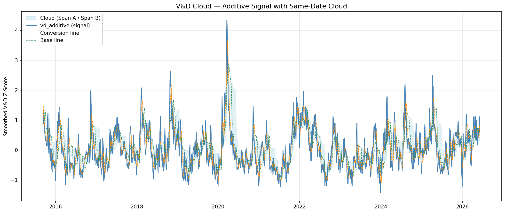
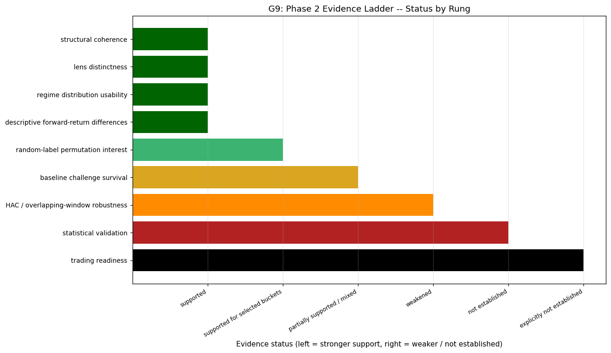
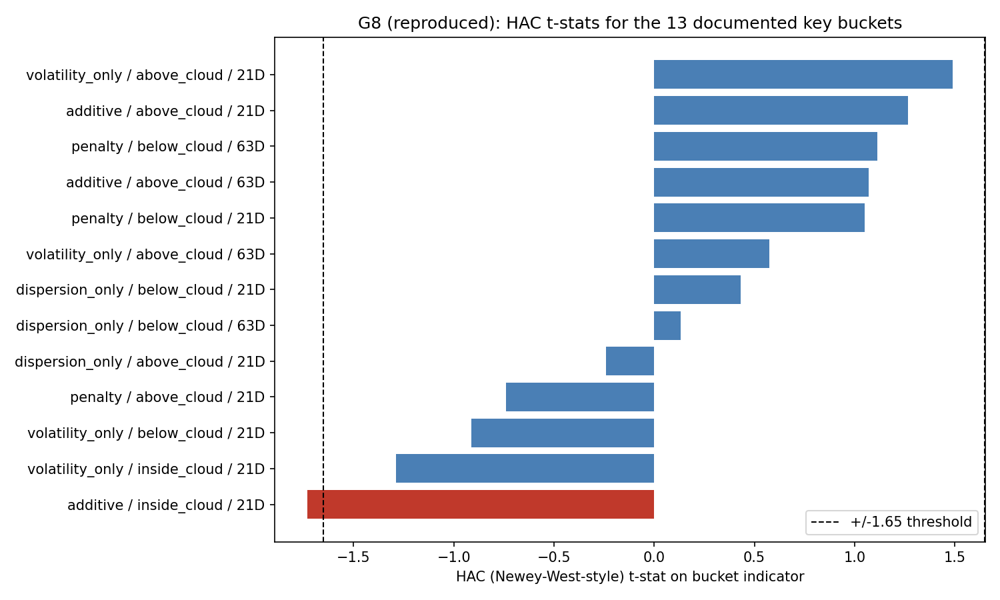
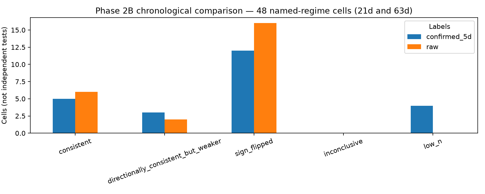

# V&D Cloud
### Can the Ichimoku cloud's regime logic work on volatility and dispersion instead of price?

A personal research project, and a negative result reported in full.

I was fascinated by the Ichimoku cloud and wanted to see whether its regime logic could become a new technical indicator built from volatility and dispersion instead of price. I started with QQQ, then extended the question to developed-market country ETFs, using the project to teach myself different volatility and dispersion measures. I compared the resulting regimes with simple baselines and examined forward returns with permutation diagnostics and HAC/Newey-West tests. The regimes were visually coherent and useful for describing market state, but the revised analysis did not establish predictive validity or a consistent advantage over simpler baselines. Learning to separate a readable picture from a supported conclusion shaped Atlas: a descriptive dashboard for exploring relative market conditions, without forecasting claims.

**The revised analysis did not establish predictive validity or a consistent advantage over simpler baselines.** See the [canonical evidence table](#verified-revised-results); exploratory threshold crossings are not validated findings.

### [Open the Atlas dashboard →](https://mjnolan37.github.io/vd-cloud/)

Atlas is the browser-based companion to this self-study research project. It turns the measures explored here into a readable TQQQ monitoring view, using QQQ as a return-alignment benchmark. No download or installation is needed to view the hosted dashboard. **It displays a manually regenerated daily-data snapshot, not live quotes.**


**Verified execution:** on October 13, 2026 (America/Los_Angeles), the revised code completed on Windows with Python 3.12.1. All 22 tests passed, including the HAC comparison. The market-data run and cached replay matched on all 27 recorded output hashes; missing-data, cloud-span, and split-boundary invariant checks passed. Figures below come from that verified run. Execution success establishes computational consistency, not statistical validity.


## Research Question and Motivation

Can Ichimoku-inspired geometry applied to a synthetic volatility-and-dispersion state variable identify descriptive market environments, and do those environments carry information about forward returns?

Ichimoku combines price-derived lines into a view of market state. This project explores applying related rolling-midpoint geometry to volatility and cross-sectional dispersion instead of price. It uses same-date spans, with no forward displacement; it is an adaptation rather than a reproduction of the traditional indicator.

It was also a deliberate way to learn realized volatility, cross-sectional dispersion, correlation-distance proxies, and rolling Z-score normalization by building and testing them. Visually coherent regimes are not evidence of a validated predictive signal.

## Data

Built independently on public market data.

The research window is **2015-01-01 through 2026-05-29**. `config.END_DATE` is `2026-05-30`, an exclusive endpoint.

- **Phase 1:** QQQ realized volatility; dispersion across the fixed 40-stock basket listed in Notebook 01; QQQ and TQQQ forward returns.
- **Phase 2 / 2B:** EFA as the primary outcome and volatility benchmark; 13 developed-market country ETFs for dispersion. URTH is context only and excluded from signal construction.
- **Atlas:** TQQQ and QQQ adjusted prices and volume, using current-year observations with pre-year warm-up data.

Downloads use `yfinance` with `auto_adjust=True`. The first run downloads Yahoo data; subsequent runs reuse hash-verified local CSV caches unless `--refresh` is requested. Yahoo can revise history, and dependencies or data availability can alter results. A new download is a rerun, not exact reproduction of an archived dataset. No redistribution permission is inferred from public accessibility; caches stay local and untracked.

Missing prices remain missing returns (`fill_method=None`). Phase 1 dispersion requires two valid stock returns; Phase 2 requires ten of thirteen ETF returns. Cache metadata records download coverage and hashes. The Phase 1 selection is not historical QQQ membership: it introduces selection/survivorship bias, includes both Alphabet share classes, and changes effective coverage as later-listed stocks enter the available data.

## Method

1. Cross-sectional dispersion and 21-day realized volatility are normalized with trailing 126-day Z-scores and smoothed over five days.
2. Signals use additive (`0.70 D + 0.30 V`) and penalty (`0.70 D - 0.30 V`) mixtures. Phase 2 evaluates dispersion-only and volatility-only lenses too. The weights are research choices, not estimated optimal allocations.
3. Same-date 9/26/52-day rolling midpoints define above/inside/below-cloud labels. Both spans must exist before labeling; boundary equality is inside-cloud. Labels use information available at that day's close.
4. Forward outcomes compound the following 5/10/21/63 trading-day returns. These descriptive close-to-close outcomes are not executable trade returns.

Shared calculations live in [`src/vdcloud.py`](src/vdcloud.py).

## Validation and Its Limits

- **Baseline comparison:** compare 21-day mean-return spreads on common available dates with prior-data expanding volatility/dispersion quartiles, price versus its available 200-day moving average, and drawdown buckets. Spread comparisons do not establish incremental explanatory power or baseline-conditioned effects.
- **HAC inference:** regress forward returns on an intercept and bucket indicator on the chronological sample. The coefficient contrasts the bucket with its complement; descriptive excess elsewhere compares against the unconditional mean. Phase 2 uses `min(horizon - 1, 63)` lags; Phase 1's 21-day diagnostic retains 21 lags. Internal missing observations stop inference rather than silently compress time.
- **Label-null checks:** 1,000 seeded shuffled-label draws provide an exploratory comparison. Circular shifts preserve most run structure and use at least one horizon of offset as a sensitivity check. They introduce a wrap boundary and assume approximate stationarity. Neither check corrects selection or multiple testing. Monte Carlo p-values use a plus-one correction and cannot be zero. **Calibration limitation:** in the reviewer's illustrative no-information simulation (200 replications), shuffled-label p ≤ 0.10 occurred in 70.0% and 78.5% of the 21/63-day cases; circular shifts yielded 9.5% and 11.5%. See [`scripts/null_calibration.py`](scripts/null_calibration.py) and the [reviewer's simulation record](results/null_calibration_review.txt). This demonstrates a failure of unrestricted shuffling under that simulated design. It does not estimate an expected count of discoveries in the selected real-data grid or prove that the observed effects are noise. Shuffled-label crossings are retained as exploratory diagnostics, not evidence of predictive validity.
- **Persistence:** require three or five consecutive observed days in the same state. Missing states break confirmation; dates without valid raw regimes are excluded.
- **Chronological comparison:** compare origins through 2020-12-31 with 2021-01-01 through 2026-05-29, excluding earlier-period outcomes whose endpoints cross the split. Rolling features carry available history into the later period. The public record does not establish a pre-2021 freeze of all choices; this is retrospective stability analysis, not a proven untouched holdout.

The `|t| >= 1.65` and exploratory `p <= 0.10` cutoffs are heuristic thresholds. The checks provide complementary, not independent, evidence. Failure to establish predictive validity is not proof that no effect exists.

## Verified Revised Results

The [headline summary](results/headline_summary.json) is generated from the exported result tables. The thirteen highlighted buckets were previously selected after inspecting descriptive outcomes; no selection or multiplicity correction is applied.

| Phase 2 check | Selected buckets crossing the threshold |
|---|---:|
| Exploratory shuffled-label p ≤ 0.10 | 9 / 13 |
| HAC absolute t ≥ 1.65 | 1 / 13 |
| Circular-shift p ≤ 0.10 | 0 / 13 |
| Shuffled-label and HAC thresholds together | 1 / 13 |

The sole HAC crossing remains `additive / inside_cloud / 21-day`: t = −1.732178, shuffled-label p = 0.003996, and circular-shift p = 0.160839. It fails the dependence-preserving sensitivity threshold. The exported `survives initial robustness` label refers only to the legacy shuffle-plus-HAC pair of heuristic bars; it does not mean a finding passed every check or was statistically validated.

At the same 21-day evaluation dates, baseline mean-return spreads were **2.637 percentage points** for drawdown buckets and **2.016 points** for realized-volatility quartiles. The largest V&D-lens spread was **1.077 points** (volatility-only), followed by **0.954 points** (additive). This descriptive comparison does not establish incremental information after conditioning on the baselines.

The chronological comparison evaluates 21/63-day excess returns for raw and five-day-confirmed labels. Among **48 named-regime cells**, **28 sign-flipped, 11 met the 50%-retained-magnitude consistency rule, 5 retained only their sign with weaker magnitude, and 4 had insufficient observations**. Across the 44 adequately sized cells, 16 retained their sign. Eight additional unconfirmed cells are reported separately: seven sign-flipped and one retained a weaker same-sign excess.

Across 24 matched named-regime comparisons, the retrospective preference rule favored raw labels in 6, confirmed labels in 4, neither in 11, and was inconclusive in 3. This provides no broad improvement from persistence confirmation. Cells share observations and overlapping outcomes; counts are not independent tests. The later period is retrospective, not a proven untouched holdout.

Phase 1's repaired 21-day HAC diagnostic had two heuristic t-threshold crossings across six lens/regime cells, but none crossed the circular-shift p threshold (smallest p = 0.103896). The result does not establish predictive validity for QQQ either.


*Revised QQQ signal geometry, October 2015–May 2026. Labels begin only after both cloud spans exist; coherent geometry is descriptive.*


*Nine shuffled-label crossings, one HAC crossing, and zero circular-shift crossings among thirteen previously selected buckets. These checks provide complementary diagnostics, not independent evidence.*


*Absolute HAC t-statistics. The red bar is the single heuristic crossing at |t| ≈ 1.73; its circular-shift p-value is 0.161.*


*The 48 named-regime cells, split by raw and five-day-confirmed labels. Unconfirmed observations are excluded from this chart and reported separately above.*

## Archived Comparison

The earlier saved implementation had 9 shuffled-label crossings and one joint shuffle/HAC crossing (|t| = 1.732182). Its 56-cell chronological grid had 31 sign flips, 14 consistent, 7 weaker same-sign, and 4 low-count cells. The revised grid has 35 sign flips, 11 consistent, 6 weaker same-sign, and 4 low-count cells, including unconfirmed states. Changes to the split purge and eligible unconditional baseline changed the counts; they should not be attributed to one fix in isolation. Historical provenance remains in [`results/archived_summary.json`](results/archived_summary.json) and Git history.

## Reproducing the Revised Analysis

The verified environment used Windows and Python 3.12.1. [`requirements-lock-windows-py312.txt`](requirements-lock-windows-py312.txt) records every installed package version from that successful run. It is a Windows/Python 3.12 lock, not a portable or wheel-hash-verified lock. [`requirements.txt`](requirements.txt) pins the eight primary dependencies to their tested versions; other platforms may resolve different transitive dependencies.

From the repository root:

```powershell
python -m venv .venv
.\.venv\Scripts\Activate.ps1
python -m pip install -r requirements-lock-windows-py312.txt
$env:VD_CLOUD_STRICT_TESTS = "1"   # a missing statsmodels fails instead of skipping
python -m unittest discover -s tests -v
python scripts/reproduce.py
python scripts/check_invariants.py
```

On macOS/Linux, install `requirements.txt`, activate with `source .venv/bin/activate`, and use `export VD_CLOUD_STRICT_TESTS=1`; that platform combination has not been validated by this Windows run. Use `--offline` to require the same cached datasets, or `--refresh` to download new ones. Add `--atlas` to regenerate the current-year HTML; combine it with `--refresh` for a current snapshot, because a cached current-year download is otherwise reused. `check_invariants.py` re-reads the cached data and confirms that missing prices produce no returns, every label has both spans, and no earlier-period outcome crosses the split. Offline replay requires a successful prior download with matching parameters; the uncached archived analysis cannot be reproduced exactly.

The runner executes notebook code in order, exports result tables and `results/headline_summary.json`, regenerates five figures, and writes data hashes, versions, commit, dirty status, run status, and output hashes to `results/run_manifest.json`. Successful execution also writes `results/requirements-run.txt`, recording the actual environment rather than claiming a prevalidated lock. The first run analyzes the parsed cache rather than the in-memory download, so an `--offline` replay should reproduce every output hash exactly. The checked-in [run manifest](results/run_manifest.json) and [invariant report](results/invariant_checks.json) describe the verified execution. Research notebook Markdown was subsequently updated without changing its executable cells. Atlas presentation cells were then revised without changing its data-calculation cells; the [layout validation record](results/atlas_layout_validation.json) records that separate change. [`results/documentation_update_provenance.json`](results/documentation_update_provenance.json) connects the validated source fingerprints to these subsequent revisions. Review future manifests and tables before revising conclusions. Failed runs can leave partial outputs; these do not constitute a completed study.

The runner leaves notebook outputs cleared. For interactive inspection, launch `python -m jupyter notebook` and execute top-to-bottom. Do not carry execution outputs across calculation changes.

## Repository Structure

```text
config.py                 # dates, universes, windows, thresholds
requirements.txt          # primary dependencies pinned to the verified versions
requirements-lock-windows-py312.txt  # full package-version record for Windows/Python 3.12
src/vdcloud.py            # shared calculations
src/repro.py              # hash-verified download cache
scripts/reproduce.py      # execution, table/figure exports, manifest
scripts/check_invariants.py  # missing-price, span and split-purge checks on cached data
scripts/null_calibration.py  # false-positive rates of the label-null checks on simulated data
tests/                    # offline behavior tests
notebooks/                # Phase 1, Phase 2, chronological comparison
figures/                  # figures from the verified revised run
results/                  # verified result tables, manifest, archived provenance
atlas/                    # notebook, verified HTML snapshot, instructions
.github/workflows/        # offline calculation checks
```

## Limitations and Next Research

These notebooks are curated from a larger private archive. The public record cannot independently establish the complete search history or when choices were frozen. The search exceeds the thirteen highlighted buckets; no formal selection or multiple-comparison correction has been applied.

The country-ETF basket differs from EFA's coverage and weights, includes Canada, and embeds currency and macro exposure. Its equal-country dispersion is not a constituent-aligned EFA decomposition. Multiplying cross-sectional dispersion by `sqrt(252)` is presentation scaling, not an estimate of portfolio volatility.

No causal mechanism, strategy backtest, sizing, transaction costs, slippage, or executable entry/exit rules have been validated. Next research should examine several rolling/expanding evaluation periods, HAC lag sensitivity, dependence-aware bootstrap analysis, and incremental baseline effects. Freeze future choices before evaluating a new period.

## How Atlas Grew from V&D Cloud

V&D Cloud began as deliberate self-study: build an Ichimoku-inspired framework on volatility and cross-sectional dispersion, learn the underlying measures, then test whether visually coherent regimes carried stable information about forward returns. The work expanded from QQQ to developed-market country ETFs and a retrospective chronological comparison. Its descriptive structure did not establish predictive validity.

Atlas grew from that process as a lighter monitoring instrument. It carries the learning about realized volatility, normalization, relative state, and careful interpretation into a dashboard that is easier to explore. It focuses on TQQQ, with QQQ as a return-alignment benchmark. Its pairwise correlation distance is distinct from the stock/country cross-sectional dispersion used in the core research; it does not inherit a validated forecasting claim from that work.

**[Open Atlas in your browser →](https://mjnolan37.github.io/vd-cloud/)** · [Dashboard guide and calculations](atlas/README.md)

The current snapshot's latest market observation is **2026-10-13**. GitHub Pages serves the saved HTML; opening the site does not download new market prices. Regenerate the dashboard and publish the updated HTML to refresh it. For offline viewing, download [`atlas/index.html`](atlas/index.html) and open it in a browser. GitHub's file viewer displays repository files; the link above opens the dashboard itself.

Publishing is handled by [the Pages workflow](.github/workflows/publish-atlas.yml), which deploys only the saved dashboard when its HTML changes on `main`. It does not execute the research notebooks or fetch Yahoo data.

## AI-Assisted Development

Development used AI assistance for scaffolding, debugging, documentation, and iterative hypothesis testing. Model definitions, validation design, interpretation, and final research judgments were mine. The work went through two rounds of **AI-assisted adversarial review** aimed at finding reasons the apparent findings should not be trusted. These were not independent human peer reviews.

## License

MIT — see [`LICENSE`](LICENSE). The code license does not grant rights to third-party market data.
